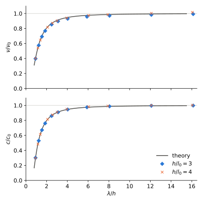
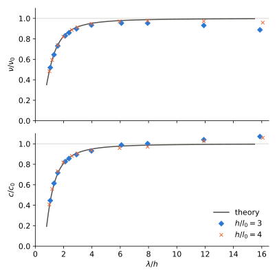
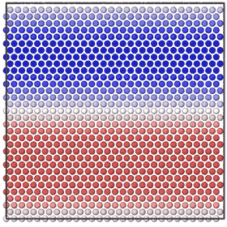
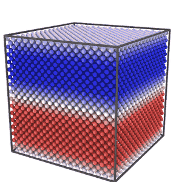

* SDPD
Smoothed dissipative particle dynamics of P. Español and M. Revenga,
Phys. Rev. E 67, 026705 (2003),
http://link.aps.org/doi/10.1103/PhysRevE.67.026705

* Derivation
| pair3.mac, pair2.mac         | pair block of M: (B3), momentum, drift, energy |
| dumbbell3.mac, dumbbell2.mac | Hookean dumbbell in GENERIC form               |
| equipartition.mac            | equilibrium of N particles                     |
| metropolis.mac               | invariant measure of the pair moves            |
| modes.mac                    | damping of shear, sound and heat waves         |
| lattice.mac                  | the same on the fcc lattice                    |

#+BEGIN_SRC sh
maxima --very-quiet -b pair3.mac
#+END_SRC

Logs are in [[file:logs]].

* CPU
[[file:sdpd2.c]], [[file:sdpd3.c]]: OpenMP, Wendland C2 kernel, -DLUCY
for Lucy.

#+BEGIN_SRC sh
make
./sdpd3 shear|sound|rest h rows eta zeta kappa kB dt steps every [amp dumpevery]
sh run.sh
maxima -b theory.mac
python3 plot.py
#+END_SRC

2D, viscosity and sound speed against theory

3D

2D, shear wave, colored by v_x

3D

* GPU
[[file:sdpd3.cu]]: one box. [[file:sdpd3b.cu]]: many boxes, one line
per box, writes out and out.k (Fourier modes).

#+BEGIN_SRC sh
make sdpd3cu sdpd3b
./sdpd3cu shear|sound|heat|rest h rows eta zeta kappa kB dt steps every [amp dumpevery]
echo "out rest 2 4 1 0 1 0.01 0.01 1000 10 0 0 7" | ./sdpd3b
sh validate.sh
#+END_SRC

Pair moves are Metropolized, G. Faure and G. Stoltz,
arXiv:1707.04232, with heat conduction added. Splitting is symmetric,
colors and pairs are shuffled every step. [[file:pairtest.c]] checks one
pair against the exact distribution.

* Statistics
[[file:stats.py]]: Gamma method over replicas, U. Wolff,
hep-lat/0306017; replica jackknife; equilibration time, J. Chodera,
J. Chem. Theory Comput. 12, 1799 (2016).

* Equipartition
N = 256, kB = 0.01, 64 replicas, sdpd3b. Exact values from
equipartition.mac.

|   dt | <m v_a^2>/<kB T>    | <dT^2>/<T>^2           |
|------+---------------------+------------------------|
| 0.01 | 0.996184 +- 0.000075 | 0.0066395 +- 0.0000011 |
| 0.02 | 0.996008 +- 0.000057 | 0.0066404 +- 0.0000008 |
| exact | 0.996094            | 0.0066407              |
